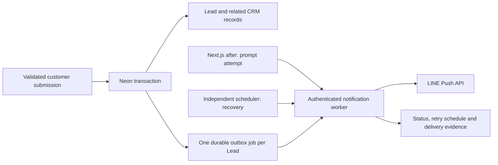

# Native LINE notifications

Engineering implementation, 2026-10-22. **Production NO-GO** until the release gates below pass.
**Latest release decision:** [RELEASE_BLOCKERS_20261022.md](RELEASE_BLOCKERS_20261022.md) records owner-selected 15-minute recovery, actual shared Neon usage and revised budget, plus no-send identity/bounded-UAT tooling. It supersedes earlier one-minute recommendations; the deployed cadence and flags are unchanged.
Neon remains the source of truth. No Production database, secrets, workflow, receiving webhook or deployment was changed.

**Current blocker closeout:** [READINESS_20261022.md](READINESS_20261022.md) confirms Hobby, commercial-use restrictions, the one recommended paid scheduling architecture, real isolated Neon UAT results, the approved Preview DB binding, and the bounded real LINE test plan. Its confirmed facts supersede the initial infrastructure unknowns below. No paid plan or scheduler has been activated.



## Scope and branch selection

- Repository has moved from `Andromedas47/landmarketthai` to `landmarketthai/landmarketthai`; the existing remote was left unchanged.
- Feature base: reviewed integration PR [#11](https://github.com/landmarketthai/landmarketthai/pull/11), branch `codex/release-integration-20261009`, commit `c1d8796`. PR #11 is OPEN/DRAFT and explicitly blocks Production auto-deployment. This feature PR targets that integration branch.
- The latest inspected Preview was `83e9362` on `codex/phaseb-upload-pause-20261012`. Its upload pause, navbar changes and receiving-webhook capture were inspected without merging them.
- `landmarketthai-line-notification-v1-draft.json`, `docs/uat/landmarketthai-line-leads-v1.md`, `src/lib/line/uat-webhook.ts` and `/api/uat/line-group-webhook` exist on that experimental branch, not the reviewed base. The JSON is an obsolete, inactive n8n draft; do not import or activate it. The UAT markdown remains historical evidence. The signed receiving webhook is independent of outbound delivery; do not change its OA configuration.
- Older release reports retain their historical n8n results. Active `src/`, environment templates and local UAT no longer invoke n8n. This runbook supersedes the old notification release requirements.

## Transaction and event coverage

`AFTER INSERT ON public.leads` writes one unique `lead_id` outbox row in the same PostgreSQL transaction. A rollback of the lead, requirement or seller submission also rolls back its notification. No historical leads are backfilled. Only the three recognized lead types with PDPA consent and a consent timestamp enqueue.

| Submission | Business entry point | Event |
|---|---|---|
| Buyer lead | `/api/leads`, `submitBuyerLead` → `insertLead` | `buyer` |
| Owner lead | `/api/leads`, `submitOwnerLead` → `insertLead` | `owner` |
| Partner registration | `/api/leads`, `submitPartnerLead` → `insertLead` | `partner` |
| Buyer requirement | `createBuyerRequirement`: lead + requirement CTE | `buyer_requirement` |
| Seller property submission | `submitPropertyDraft`: locked draft + lead + submission CTE | `seller_submission` |

Draft saves, failed validation, rate-limit rejections, honeypots and failed/repeated seller submission do not enqueue. Requirement and seller records reuse their lead event; no second enqueue exists. Separate valid form submissions remain separate business events: this feature does not deduplicate customers by phone or name.

Every successful public entry point schedules a bounded `after()` callback. The callback is a latency optimization; if it is interrupted or never runs, the database job survives. LINE outages never undo an already saved lead. A database failure during the transactional enqueue rolls back the business operation, as any other database write failure does; there is no network call in the transaction.

## Worker and LINE semantics

- `GET` or `POST /api/internal/line-notifications` requires `Authorization: Bearer <CRON_SECRET>` with an independent random secret of at least 32 characters. No user session or public form can call it successfully without that secret. Request bodies and query parameters cannot supply events, destinations or message text.
- Claims are atomic `UPDATE ... SELECT ... FOR UPDATE SKIP LOCKED`. A fresh UUID lease token fences updates from old workers. Leases expire after two minutes. Each sweep claims at most three jobs sequentially, stopping after approximately 20 seconds plus its final operation; each LINE fetch has a five-second timeout. The route permits at most 60 seconds. Database interruption leaves the lease recoverable.
- States: `pending → processing → sent | retry | failed`; expired `processing` can be reclaimed. Eight claims maximum, including interrupted attempts. Retry delay is 30, 60, 120, 240, 480, 960, 1920 seconds; the eighth failure is terminal. The helper caps longer exponential delays at one hour. A valid `Retry-After` delta or HTTP date can increase the delay. 429 stops the current sweep; other invocations still respect each job's due time. This is a low-volume sender, not a global LINE account rate limiter; other senders sharing the channel must be considered during UAT.
- Timeouts, network errors, HTTP 408, 429 and 5xx retry. Other HTTP failures, including 400/401/403 and 409 without acceptance evidence, become terminal failures. Fix credentials/configuration and reconcile the affected jobs before any operator replay.
- A persisted v4 UUID is sent as `X-Line-Retry-Key` on the first attempt and all retries. HTTP 409 with a valid `x-line-accepted-request-id` counts as accepted. An immutable request fingerprint binds the group destination, message text and admin URL across attempts; configuration drift fails closed instead of silently changing a retried request.
- Ambiguous sends stop after 23 hours from the first claim, inside LINE's 24-hour key validity window. Unattempted jobs expire after seven days. Expired jobs require human reconciliation; the worker never generates a fresh key for them automatically. `sent` means LINE accepted the request, not that a group member read or received it. [LINE retry contract](https://developers.line.biz/en/docs/messaging-api/retrying-api-request/).
- Only event type and a fixed Thai status/admin link are sent. Names, phone numbers, email, free text, identities, attachments and lead IDs are omitted. The admin page enforces existing admin authorization.
- Server-only token/group ID; no secrets in source, bodies of error logs or responses. Database evidence stores the request ID, HTTP code, error category, attempts and timestamps; response bodies are discarded. RLS and revoked browser-role grants protect the outbox. Apply the migration as the exact server application owner role (currently documented as `landmarketthai_owner`); it intentionally grants no anonymous write capability and uses no security-definer bypass.

## Scheduling decision and actual hosting evidence

Inspected Vercel team `team_f240D2rDbl2cx6m4mArDo0n7`, project `prj_xCFIVfdJloEza76QmmEYotafCFne` (`landmarketthai`), Node 24, region `sin1`. Team/project connector responses omit the plan field. Billing-capability read returned `plan_not_supported`, zero slots and “upgrade to Pro or Enterprise.” Local CLI had no token, and the billing page redirected to login. **Exact billing plan remains unverified**; this is evidence of a non-Pro capability, not proof of an exact plan name. An owner must verify it before release.

| Option | Behavior and cost | Decision |
|---|---|---|
| `after()` on a committed submission | Usually seconds when the runtime executes it; no durability promise | Implemented for prompt attempts |
| Vercel daily Cron | Included cron trigger; function/DB usage still counts. Hobby is once daily, within the scheduled hour | `vercel.json` has `17 2 * * *` (09:17 Bangkok nominal). Recovery/monitoring backstop only; Production-only scheduler |
| Vercel minute Cron | Requires a compatible paid plan; no change authorized | Use only if the existing plan is verified to support it; do not upgrade automatically |
| Free external HTTP scheduler | [cron-job.org](https://cron-job.org/en/faq/) documents minute frequency and custom headers; no delivery SLA assumed | Concrete no-subscription-cost option, not provisioned. Owner must approve secret sharing/account and verify service terms |
| Neon scheduled Function | Existing Neon region Singapore supports Functions; scheduled triggers can wake suspended compute | Alternative within existing vendor; verify entitlement and incremental compute cost first. Not provisioned |
| GitHub scheduled Actions | Can be delayed or dropped; not guaranteed real-time | Rejected as the primary recovery mechanism |
| `pg_cron` inside suspended Neon compute | Stops when compute suspends | Rejected as an independent wake-up mechanism |

[Vercel scheduling limits](https://vercel.com/docs/cron-jobs/usage-and-pricing), [Next.js 15 after lifetime](https://nextjs.org/docs/15/app/api-reference/functions/after), [Neon scheduled Functions and pg_cron caveat](https://neon.com/blog/your-neon-functions-can-now-run-on-a-schedule), [GitHub schedule delays](https://docs.github.com/en/actions/reference/workflows-and-actions/events-that-trigger-workflows#schedule).

Daily Cron alone is **not reliable near-real-time retry**: retries may wait roughly a day, exceed the 23-hour deduplication window, and go to dead letter. It can process only three due jobs per invocation. No user traffic is required for an authorized scheduler request, but independent minute scheduling must be activated and verified before promising minute-scale recovery.

Concrete free-scheduler configuration after approval: call the stable environment-specific HTTPS `/api/internal/line-notifications` URL every minute with POST and only the Authorization bearer header; do not put the secret in the URL. Use a 30–60 second timeout, enable execution-failure notifications, and alert on returned `failed > 0`, `stuck > 0`, or `oldest_pending` older than five minutes. Respect Vercel Preview protection using an explicitly scoped bypass header if required; do not disable protection. Never aim a test scheduler at Production. Verify an idle period and a forced timeout retry on the approved test destination. Capacity is approximately three attempts/minute for one schedule (4,320/day), less when retries consume attempts. Add capacity only after measuring backlog and LINE quota.

Expected incremental recurring subscription cost for the implemented code: $0. Existing Vercel function invocations, Neon compute/storage and LINE OA push quota still apply. Minute scheduling means about 43,200 sweeps per 30 days and can keep Neon warm, so a $0 total bill is **not** guaranteed. No paid service, plan upgrade or new Neon compute was activated. Normal first attempts target seconds; approved minute scheduling targets the next tick after backoff plus runtime/cold-start delay, without a hard SLA. No external latency has been measured yet.

## Configuration and migration

Use `.env.local.example`. Required for sending: `LINE_NOTIFICATIONS_ENABLED=true`, server-only `LINE_CHANNEL_ACCESS_TOKEN`, `LINE_NOTIFICATION_GROUP_ID` (`C` plus 32 hex characters), and an HTTPS `NEXT_PUBLIC_SITE_URL` pointing at that environment. `CRON_SECRET` protects external dispatch. Missing/invalid configuration leaves jobs untouched, skips `after()` delivery and makes authorized worker calls return 503. Use a different secret/destination per environment. Never copy Production secrets into tests.

The feature branch's automatic Preview is configured for build/smoke checks only: independent cookie secret, `.invalid` Auth URL, human verification required and LINE disabled. No isolated database or LINE credentials have been provisioned there. Replace the placeholder with an approved isolated Auth endpoint and configure the isolated DB before any form UAT; never use the Production Auth fallback. See the QA report for the initial build failure and repair.

Migration: `neon/migrations/202610220001_line_notification_outbox.sql`, transaction with lock/statement timeouts. It adds a private table, indexes, function and trigger; no existing lead values are updated. The trigger and table are safe to reapply. No legacy backfill. Rehearsal uses disposable PostgreSQL 18 with the full repository schema chain, synthetic data and the real business SQL. Neon-specific application-role ownership and Data API isolation must still be checked on an isolated Neon branch before release.

Read-only preflight, run through the explicitly selected application role/branch:

```sql
SELECT current_user, current_database();
SELECT tableowner FROM pg_tables WHERE schemaname='public' AND tablename='leads';
SELECT id, lead_type, consent_pdpa, consent_at FROM leads LIMIT 0;
-- After migration, confirm owner matches the server role and browser privileges are false:
SELECT tableowner, rowsecurity FROM pg_tables WHERE tablename='line_notification_outbox';
SELECT has_table_privilege('anonymous','public.line_notification_outbox','SELECT');
```

Role/database names alone do not prove branch identity: record project, branch and endpoint mapping before connecting. Use a direct/unpooled connection for migration. If a server role is not the migration owner, review explicit least-privilege grants/RLS before applying; do not silently grant access to public roles.

## Monitoring, retention and recovery

Authenticated sweeps return counts of pending/retry/failed/stuck jobs and the oldest outstanding timestamp and log these aggregate fields. Error logs contain a job UUID and a finite category, never private customer data. The worker logs configuration/availability failures generically. There is no newly provisioned external alert service: connect the scheduler’s failure alert and review these metrics before release.

```sql
SELECT status, count(*), min(created_at) AS oldest, max(updated_at) AS latest
FROM public.line_notification_outbox GROUP BY status;
SELECT id, event_type, attempts, last_error, last_http_status, line_request_id,
       first_attempt_at, available_at, lease_until
FROM public.line_notification_outbox WHERE status='failed' ORDER BY updated_at DESC LIMIT 50;
```

Each enabled sweep deletes at most 1,000 terminal rows: sent after 30 days, failed after 90 days. Pending age is limited to seven days, then retained as failed for review. Run the scheduler continuously and monitor growth/backlog; disabled delivery also disables housekeeping. If disabling for an extended period, remove the enqueue trigger with the rollback script or arrange separately authorized cleanup. Cleanup never deletes leads, requirements or submissions. The unique lead constraint plus insert-only trigger prevents normal updates from recreating a deleted terminal job; operators must not fabricate events or manually backfill old leads.

Do not reset `first_attempt_at`, rotate retry keys, or blindly replay `failed` rows: LINE may already have accepted the request. Check acceptance evidence, LINE destination history and the original 23-hour window. A short-window retry after a corrected issue requires an authorized operator decision using the same key/fingerprint, with the attempt ceiling respected. Older ambiguous jobs need explicit reconciliation and, if necessary, a separately approved new alert.

## Production cutover and rollback (separate approval required)

1. Keep PR #11 and this PR unmerged. Confirm auto-deploy suppression/release procedure, actual hosting plan, scheduler choice, test group authorization and isolated Neon ownership. Existing security/zoning migration gates from PR #11 still apply.
2. Rehearse on an isolated Neon branch with synthetic events and no Production credentials. Take the Production restore point only as part of an explicitly approved release.
3. Deploy compatible DB changes as the application owner. Existing application writes continue; old n8n delivery still operates until switch. The new trigger queues overlap events but must not send them yet. Validate old application compatibility and record the exact cutover boundary.
4. Deploy to Preview with the isolated DB, notification sending initially disabled, approved test destination and independent test credentials. Verify all five paths, timeout/429 handling, duplicate acceptance, no private data, lease recovery, retention, monitoring and scheduled retry during no traffic. Real LINE test sends need explicit authorization; none were sent in this engineering run.
5. Resolve exact plan/scheduling/cost questions and obtain explicit Production migration/deploy/delivery approval. Do not use the daily backstop as evidence of near-real-time recovery.
6. At the approved switch, briefly gate customer writes or route them entirely to the reviewed new deployment with delivery disabled. Drain/stop all old deployment traffic and in-flight webhook calls, and reconcile old n8n executions. Mark/quarantine outbox rows created during the old-sender overlap (`failed` with an operator cutover category), including their exact IDs and boundary in release evidence. Do not send those rows again automatically. If there is no way to prove all old invocations drained, keep delivery off and remain NO-GO.
7. Enable only the new sender for events committed after the proven boundary; activate the approved independent scheduler, restore writes, verify one authorized Production event and observe backlog/error metrics. Old deployments must receive no new writes. The same active leads must never be sent by both systems.
8. Only after verification disable the old n8n workflow and remove obsolete Production environment variables. Those operations are not part of this engineering authorization. Keep the receiving LINE OA webhook unchanged.

Rollback: disable `LINE_NOTIFICATIONS_ENABLED`, stop scheduler invocations, drain active leases/in-flight requests, then run `scripts/line-notification-rollback.sql` as the owner. The script removes only the enqueue trigger/function, is repeatable, and preserves all outbox evidence and CRM data. Roll back the app through the approved release procedure. **Do not immediately reactivate old notifications**: reconcile all events accepted by LINE and all overlap jobs first. Reapplying the migration restores future enqueueing without backfilling leads. An app rollback without removing the trigger can collect overlap jobs; quarantine them before reenabling native delivery.

## Local verification

```powershell
npm test
npx tsc --noEmit
npm run lint
# Build with synthetic local auth settings and no DATABASE_URL (see QA report).
npm run build
docker run -d --name lmt-line-pg18-20261022 -e POSTGRES_PASSWORD=uat_local_only -e POSTGRES_DB=e2e postgres:18
node --import ./scripts/register-ts-paths.mjs scripts/line-notification-db.test.mjs
```

The DB suite creates a fresh `line_<timestamp>` database and prints its name. It checks the real trigger and business SQL, rollback, constraints, concurrent sessions, leases and the real worker with mocked LINE. For HTTP UAT, connect the local Neon proxy to that new database on loopback port 4444, set `UAT_PG_CONTAINER` and `UAT_PG_DB` to those disposable identifiers, then run `node scripts/uat-local-e2e.mjs`. The preload blocks other fetch egress and simulates LINE (one timeout) and Turnstile. Storage points to `.invalid`. Never run these fixtures against Neon Production or shared UAT.
